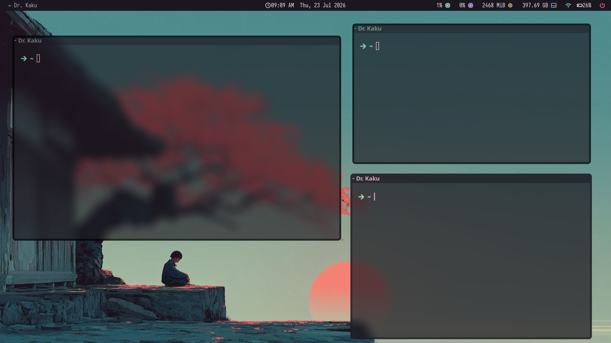

<div align="center">

# 🖥️ I3WM-configFiles

*A fast, GPU-accelerated i3wm desktop — translucent terminals, dot-style bar, zero-gap tiling.*


-F4A261)




</div>

---

## Contents

- [Features](#features)
- [Layout](#layout)
- [New machine setup](#new-machine-setup)
- [Switching polybar themes](#switching-polybar-themes)

## Features

- **Zero-gap i3 tiling** — dense, edge-to-edge layout, no wasted screen space
- **GLX-accelerated picom** — translucent, blurred, rounded-corner kitty terminals; every other window stays flat and cheap so the compositor costs next to nothing (see `picom/picom.conf` for the reasoning)
- **polybar** with a dot-style workspace indicator as the default theme, plus several alternate layouts to switch between
- **rofi** launcher/power-menu/keyhints, **dunst** notifications, **fish** shell, **tmux**
- **One-command install** — `./install.sh` symlinks everything straight into `~/.config`, backing up anything already there

## Layout

| Path | What it is |
|---|---|
| `i3/` | i3 config, keybindings, i3blocks config, and status scripts |
| `polybar/` | Multiple polybar themes/layouts (only one active at a time, see `polybar/launch.sh`); `polybar/rice/` is the default — single top bar, dot-style workspace indicators |
| `picom/picom.conf` | Compositor config — transparency, blur, rounded corners. Runs on the `glx` backend, not `xrender` (xrender compositing runs on the X server's CPU and pegs a core once blur/corners are on, causing system-wide input/scroll lag). Blur and rounded corners are both scoped to `kitty` only, since `dual_kawase` blur is the expensive part and every other window skips it entirely. `unredir-if-possible = true` lets fullscreen windows (video, games) bypass the compositor altogether. |
| `kitty/kitty.conf` | Primary terminal — pastel dark theme, translucent background |
| `fastfetch/config.jsonc` | System-info fetch tool, ASCII distro logo (no image) |
| `rofi/` | App launcher, power menu, and keyhint themes |
| `dunst/` | Notification daemon config |
| `terminal/` | xfce4-terminal xfconf export, kept as a non-transparent fallback terminal |
| `xfce4/helpers.rc` | Sets kitty as the XFCE-wide preferred terminal (`exo-open --launch TerminalEmulator`), so Thunar's "Open Terminal Here" and similar launch kitty instead of xfce4-terminal |
| `flameshot/flameshot.ini` | `useX11LegacyScreenshot=true` — current flameshot builds default to the xdg-desktop-portal backend, which doesn't exist on i3 (`flameshot gui` fails with "Screenshot aborted" otherwise). Forces flameshot back to Qt's native X11 capture, bound to `Ctrl+Shift+S` in `i3/config`. |
| `tmux/tmux.conf` | Tmux config |
| `fish/` | `config.fish`, `conf.d/`, `functions/` |
| `gtk/settings.ini`, `xsettingsd/xsettingsd.conf` | GTK theme (Arc-Dark / Qogir-dark / Qogir-Light cursor) |
| `systemd/wake-alarm.service` | System unit bound to `$mod+F12` (stop wake alarm) |

## New machine setup

1. **Install packages:** `i3` `polybar` `rofi` `dunst` `xfce4-terminal` `kitty` `fastfetch` `tmux` `fish` `picom` `feh` `flameshot` `brightnessctl` `i3blocks` `xkblayout-state` `power-profiles-daemon`, the `arc-gtk-theme` / `qogir-icon-theme` / `qogir-cursor-theme` (AUR) packages, `ttf-iosevka-nerd` (polybar/kitty/bar font), plus anything referenced by scripts in `i3/scripts/` (e.g. `nordvpn` for the vpn blocklet).
2. **Clone and link:**
   ```sh
   git clone https://github.com/subashsigdel/I3WM-configFiles.git && cd I3WM-configFiles
   ./install.sh
   ```
   This symlinks everything into `~/.config/...` (and installs the systemd unit if run with sudo access), backing up any existing files as `*.bak`.
3. **Set fish as the login shell:**
   ```sh
   chsh -s "$(command -v fish)"
   ```
4. **Wallpaper:** the path in `i3/config` (`feh --bg-fill ...`) is machine-specific — copy over `~/Pictures/wallpaper/` (not tracked in this repo — personal images) and update the path if the filename differs.
5. **Weather blocklet (optional):** put a real OpenWeather API key into `i3/scripts/openweather` / `openweather-city` (currently placeholders).
6. **Wake alarm (optional):** `wake-alarm.service` expects `~/vs/Laptop_sh/wake_alarm.sh` to exist — that script lives outside this repo, bring it over separately.
7. **Pinchtab (optional):** the fish `pinchtab-kill`/`pinchtab-status` functions expect a `pinchtab` install (see `~/vs/pinchtab` on the old machine) — bring that over too if you use it.
8. Log out and start an i3 session.

## Switching polybar themes

```sh
polybar/launch.sh --<theme>   # e.g. --rice, --hack, --material
polybar/launch.sh             # no args: lists all available themes
```

The active theme is set in `i3/config`'s `exec_always ... polybar/launch.sh` line.
